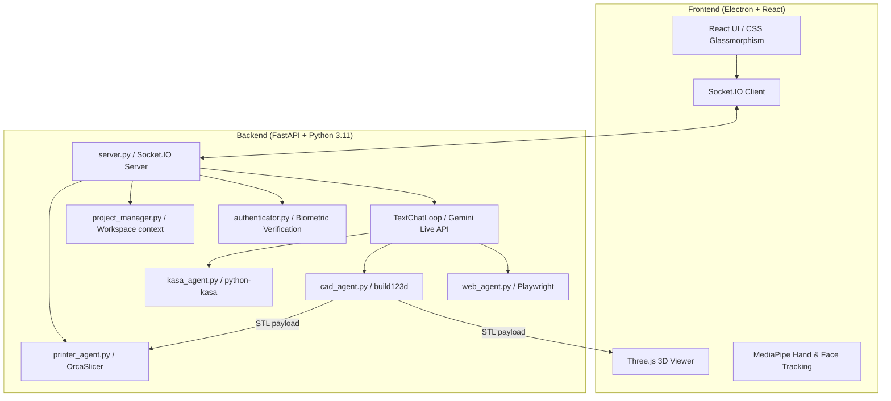

# Smarty — Premium AI Desktop Assistant & Workspace Controller


Smarty is a premium, cutting-edge AI desktop assistant that brings autonomous intelligence and space-age workspace controls directly to your computer. By combining Google's Gemini Native Audio, local computer vision, hand gesture window manipulation, parametric 3D CAD design, and smart home automation, Smarty is the ultimate command center for engineers, creators, and developers.

---

## 🌟 Premium Capabilities

| Feature | Description | Core Technology |
|:---|:---|:---|
| **🗣️ Real-Time Voice** | Ultra-low latency voice conversation with smart interrupt handling | Gemini Live API / Native Audio |
| **🧊 Parametric CAD** | Voice-driven 3D CAD modeling with real-time visual output | `build123d` → STL Pipeline |
| **🖨️ 3D Printing Integration** | Seamless OrcaSlicer G-code preparation and wireless print submission | OrcaSlicer + Moonraker / OctoPrint |
| **🖐️ Holographic Gestures** | Minority Report-style window resizing and repositioning in real-time | MediaPipe Hand Tracking |
| **👁️ Biometric Auth** | Secure local unlock screen with face recognition | MediaPipe Face Landmarker |
| **🌐 Web Agent** | Autonomous browser controller for research and tasks | Playwright + Chromium |
| **🏠 Smart Workspace** | Ambient environment controller for smart lamps and workspace plugs | `python-kasa` Integration |
| **📂 Project Context** | Persistent workspace context and active memory | JSON Project Manager |

---

## 🖐️ Gesture Control Schema

Move your hand in front of your webcam to manage modular UI windows dynamically:

| Gesture | Action |
|:---|:---|
| 🤏 **Pinch** | Click UI buttons, focus inputs, or authorize tasks |
| ✊ **Close Fist** | Select and drag any window to a new position |
| ✋ **Open Palm** | Release the window and drop it in place |

> **Pro-Tip**: Toggle the Video HUD from the toolbar to see the live skeletons, eye-tracking reticle, and object detection bounding boxes.

---

## 🏗️ Architecture Design



---

## ⚡ Quick Start for Developers

### 1. Prerequisites
- **Python 3.11** (recommended via Anaconda or Miniconda)
- **Node.js 18+**
- **OrcaSlicer** (Required if using 3D Printing features)
- **Google Gemini API Key**

### 2. Setup Guide

```bash
# Clone the repository
git clone https://github.com/Satwik-Singh6002/Smarty.git
cd Smarty

# Set up Python virtual environment
conda create -n smarty python=3.11 -y
conda activate smarty

# Install Python requirements
pip install -r requirements.txt
playwright install chromium

# Install frontend dependencies
npm install
```

### 3. API & Environment Keys
Create a `.env` file in the root directory:
```env
GEMINI_API_KEY=your_gemini_api_key_here
```

### 4. Running the App
Start both the React development server, Electron shell, and Python backend concurrently with a single command:
```bash
npm run dev
```

---

## 🛠️ Build and Distribution
To package Smarty into a self-contained, distributable desktop application (`.exe` for Windows, `.dmg` for macOS):

```bash
# Package for host OS
npm run dist

# Package specifically for Windows
npm run dist:win

# Package specifically for macOS
npm run dist:mac
```
Distributed installers are saved directly to the `/release` folder.

---

## 📄 License & Terms
Smarty is distributed under the MIT License. See [LICENSE](LICENSE) for details.
For privacy information regarding local camera streams and face biometric hashing, see [PRIVACY.md](PRIVACY.md).
